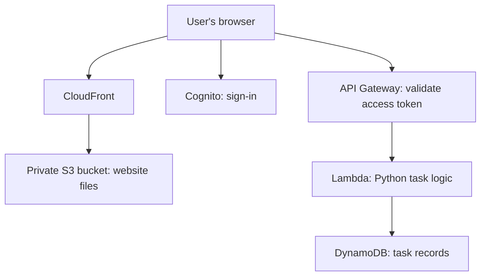

# AWS Serverless Task Tracker with Terraform

A web application where users sign in and manage their own tasks. Built with HTML, CSS, JavaScript, Python, and AWS, with infrastructure managed through Terraform.

## Live Website

https://d3ggi3c7to5s7a.cloudfront.net/

An account is required to manage tasks. Demo availability depends on the AWS resources remaining deployed.

## Features

- Sign up, sign in, and sign out.

- Create and view tasks.

- Mark tasks as Pending or Completed.

- Filter tasks by All, Pending, or Completed.

- Delete tasks after confirmation.

- Store tasks in DynamoDB.

- Associate tasks with the signed-in user.

## Architecture

CloudFront serves the website files stored in S3. Cognito handles sign-in.

After sign-in, the browser sends API requests with an access token. API Gateway validates the token and passes the request to Lambda.

Lambda uses the verified user identity to access that user's tasks. Its IAM role grants permission to access DynamoDB.

Responses return through API Gateway to the browser.

## What Terraform Does

Terraform creates and configures the AWS resources and their connections:

- DynamoDB table

- Lambda function

- IAM role and policies

- CloudWatch log group

- API Gateway routes, integration, and JWT authorizer

- Cognito user pool, app client, and domain

- Private S3 bucket

- CloudFront distribution and origin access control

Terraform runs when infrastructure changes are applied. It does not run when users add or update tasks.

Website files are uploaded separately using the AWS CLI.

## API Routes

All routes require a valid Cognito access token.

| Method | Route | Purpose |

|--------|-------|---------|

| POST | /tasks | Create a task |

| GET | /tasks | List the signed-in user's tasks |

| GET | /tasks/{task_id} | Retrieve a task |

| PATCH | /tasks/{task_id} | Change a task's status |

| DELETE | /tasks/{task_id} | Delete a task |

The All, Pending, and Completed filter buttons operate in the browser and do not modify DynamoDB.

## Task Data

Each task contains:

| Attribute | Purpose |

|-----------|---------|

| task_id | Unique task identifier and table partition key |

| user_id | Cognito identity of the task owner |

| title | Task description |

| status | Pending or Completed |

| created_at | Creation timestamp in UTC |

## Project Files

| File | Purpose |

|------|---------|

| terraform.tf | Terraform and provider requirements |

| main.tf | AWS provider, database, Lambda, permissions, and logging |

| api.tf | API Gateway configuration |

| auth.tf | Cognito configuration |

| hosting.tf | S3 and CloudFront configuration |

| outputs.tf | Resource URLs and identifiers |

| lambda/app.py | Backend task operations |

| website/index.html | Website structure |

| website/styles.css | Website styling |

| website/app.js | Sign-in, API requests, and task interactions |

| .terraform.lock.hcl | Selected provider versions |

| .gitignore | Files excluded from Git |

## Deployment Overview

This configuration currently contains settings specific to the original AWS account. Review and adapt it before deploying elsewhere.

Prerequisites:

- AWS account and appropriate permissions

- Terraform

- AWS CLI with working authentication

- Python for optional local website testing

Deployment steps:

1. Configure AWS authentication and update the provider profile.

2. Review resource names, account-specific values, and Cognito domain.

3. Package `lambda/app.py` as `lambda.zip`, with `app.py` at the ZIP root.

4. Run `terraform init`.

5. Run `terraform validate`.

6. Run `terraform plan` and review the proposed changes.

7. Run `terraform apply`.

8. Configure Cognito callback/logout URLs and API CORS for the deployed website.

9. Update the frontend API and Cognito settings for the new deployment.

10. Upload the website files to the S3 bucket.

11. Test sign-in and task operations through the CloudFront URL.

Terraform state, local credentials, Python environments, and generated ZIP files are excluded from this repository.

## Manual Verification

The following behaviors were checked:

- Sign-in through Cognito.

- Task creation and matching records in DynamoDB.

- Status updates and persistence after refreshing.

- Task deletion and removal from DynamoDB.

- Separate task lists for different signed-in users.

- Browser filters for All, Pending, and Completed.

- API requests inspected using browser Developer Tools.

## Learning Scope and Limitations

This is a learning and portfolio project.

The task list currently uses a DynamoDB Scan with an ownership filter. A larger application would benefit from a key design that supports querying tasks directly by user.

Additional improvements could include automated tests, CI/CD, monitoring alerts, and shared remote Terraform state.

## AWS Costs

AWS usage can consume credits or incur charges. Uploading the code to GitHub does not stop or remove the deployed AWS resources.

